 

## 💼 Experience & Research

<table>
  <thead>
    <tr>
      <th width="200">Role & Org</th>
      <th width="150">Timeline</th>
      <th>Key Deliverables & Architecture</th>
    </tr>
  </thead>
  <tbody>
    <tr>
      <td><strong>AI Engineer</strong> <code>UBS</code></td>
      <td>Aug 2024 – Present</td>
      <td>
        • Engineered <strong>Risk Issue Assistant (SRM)</strong>: Automated issue closure inference across nested docs. 
        • Built <strong>Advanced RAG Regulatory Assistant</strong>: Evidence linking, SME auto-routing, parsing. 
        • Architected <strong>Centralized Knowledge Store</strong>: Plug-and-play vector/context memory for downstream agents.
      </td>
    </tr>
    <tr>
      <td><strong>Research Scholar</strong> <code>Space Applications Centre (ISRO)</code></td>
      <td>Jul 2023 – Jan 2024</td>
      <td>
        • Satellite imagery & geospatial ML pipelines. 
        • EV charging infrastructure optimization and defense/transport asset detection from orbit.
      </td>
    </tr>
  </tbody>
</table>

 

## 🚀 Featured Projects

<table>
<tr>
<td width="50%" valign="top">

### 💬 [whatsapp-total-recall](https://github.com/vyavahareyash/whatsapp-total-recall)
*Zero-cost, privacy-first conversational intelligence engine & MCP server for WhatsApp.*

- 🔍 Hybrid retrieval (BM25 + sqlite-vec RRF) over local chat history
- 💬 Rebuilds reply DAGs & conversational episodes with zero cloud egress
- 🔌 Native Model Context Protocol (MCP) server & macOS menu bar app

  

 

[**Repo ↗**](https://github.com/vyavahareyash/whatsapp-total-recall)

</td>
<td width="50%" valign="top">

### ⚡ [openrouter-tracker](https://github.com/vyavahareyash/openrouter-tracker)
*Real-time token, credit, and latency tracker for multi-model LLM deployments via OpenRouter.*

- 📊 Real-time token consumption & cost metering
- ⏱️ Route optimization across model providers
- 🛡️ Budget caps and alert thresholds for LLM APIs

  

 

[**Repo ↗**](https://github.com/vyavahareyash/openrouter-tracker)

</td>
</tr>
<tr>
<td width="50%" valign="top">

### 💰 [cashflow](https://github.com/vyavahareyash/cashflow)
*Intelligent financial telemetry and cashflow intelligence engine.*

- 📈 Predictive cashflow modeling with trend breakdown
- ⚡ Automated ledger transaction categorization
- 🔒 Privacy-first local data parsing & aggregation

  

 

[**Repo ↗**](https://github.com/vyavahareyash/cashflow)

</td>
<td width="50%" valign="top">

### 🧠 AI-Architect
*Hackathon Winner @ UBS · Automated code-to-architecture engine.*

- 📐 Parses repo AST and codebase files to produce system diagrams
- 🗣️ Natural language prompt → complete visual system topology
- ⚡ Accelerated onboarding & architecture review cycles

  

 

</td>
</tr>
</table>

 

## 🏆 Honors & Hackathons

| Recognition | Issuing Body | Project |
| :--- | :--- | :--- |
| 🥇 **Winner (Leader's Choice)** | UBS Tech Unleashed (2025) | AI Architect |
| 🥇 **Winner** | UBS Data Science Guild Hackathon (2025) | AI Architect |
| 🥈 **2nd Position** | NES Innovation Awards (2024) | River Pollution & Drone Quantification |
| 🥇 **Winner** | NASA Space Apps Challenge Hackathon (2023) | Deforestation Detection |

 

## 🛠️ Tech Stack

**🤖 GenAI & Agents**

**🧠 Machine Learning & Vision**

**⚙️ Core & Infrastructure**

 

## 📊 Contribution Stream

<picture>
  <source media="(prefers-color-scheme: dark)" srcset="https://raw.githubusercontent.com/vyavahareyash/vyavahareyash/output/profile-night-rainbow.svg" />
  <source media="(prefers-color-scheme: light)" srcset="https://raw.githubusercontent.com/vyavahareyash/vyavahareyash/output/profile-green-animate.svg" />
  
</picture>

  

<picture>
  <source media="(prefers-color-scheme: dark)" srcset="https://github-readme-stats.vercel.app/api?username=vyavahareyash&show_icons=true&theme=github_dark&hide_border=true&count_private=true&include_all_commits=true" />
  <source media="(prefers-color-scheme: light)" srcset="https://github-readme-stats.vercel.app/api?username=vyavahareyash&show_icons=true&theme=default&hide_border=true&count_private=true&include_all_commits=true" />
  
</picture>
&nbsp;
<picture>
  <source media="(prefers-color-scheme: dark)" srcset="https://github-readme-streak-stats.herokuapp.com/?user=vyavahareyash&theme=github-dark-blue&hide_border=true" />
  <source media="(prefers-color-scheme: light)" srcset="https://github-readme-streak-stats.herokuapp.com/?user=vyavahareyash&theme=default&hide_border=true" />
  
</picture>

 

 

  
  &nbsp;&nbsp;
  

