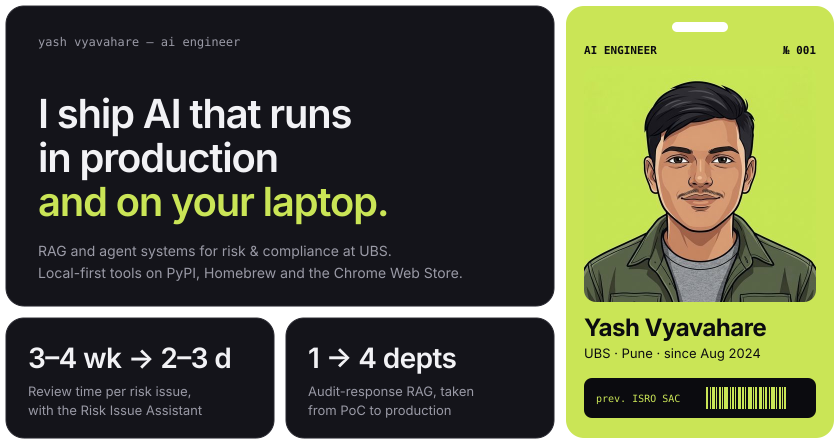
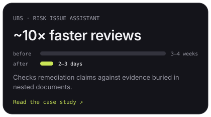
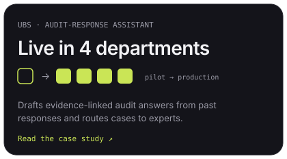
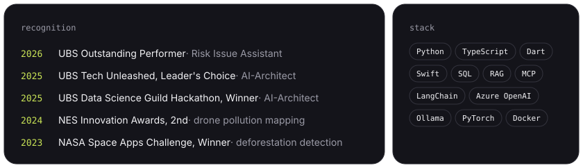

<!-- Tiles are generated: edit scripts/build_assets.py, then run `python3 scripts/build_assets.py`.
     The contribution tile is rebuilt daily by .github/workflows/contributions.yml onto the `output` branch. -->

