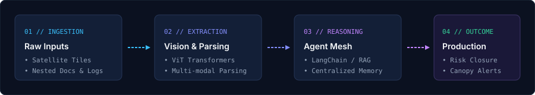
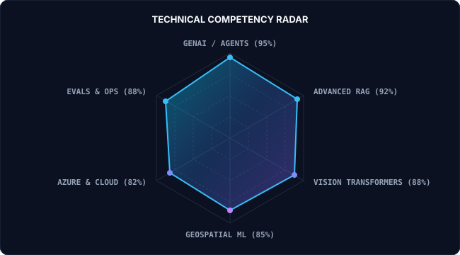

# 🎨 Custom SVG Showcase & Gallery

> Bespoke SVGs engineered for **Yash Vyavahare's GitHub Profile**.
> All assets are located under [`./assets/`](file:///Users/yash/.gemini/antigravity/scratch/github-profile/assets).

---

### 1. Cyber-Orbit Hero Banner (`assets/hero.svg`)
- **Purpose:** Top-of-profile visual identity replacing generic text headers.
- **Features:** Dark-slate canvas (`#0A0E17`), subtle grid mesh, pulsing green status pill (`PRODUCTION AI @ UBS`), NASA crest badge, telemetry footer with blinking cursor.

<div align="center">
  
</div>

---

### 2. Terminal Session Window (`assets/terminal.svg`)
- **Purpose:** Hacker/terminal aesthetic bio box replacing ASCII boxes.
- **Features:** macOS/Linux window controls, syntax-highlighted JSON payload, dynamic blinking prompt.

<div align="center">
  
</div>

---

### 3. Frontier Architecture Pipeline (`assets/pipeline.svg`)
- **Purpose:** Visually explains your end-to-end AI capabilities (Satellite Vision + Enterprise RAG).
- **Features:** 4-stage pipeline (Ingestion ➔ Vision/Parsing ➔ Agent Mesh ➔ Production Outcome) with dotted animated-style arrows.

<div align="center">
  
</div>

---

### 4. Brutalist Tech Divider (`assets/divider.svg`)
- **Purpose:** Replaces markdown horizontal rules (`---`) with stylized hairline dividers.
- **Features:** Clean brutalist gradient accent hairline (`#00E5FF` → `#0078D4`) seamlessly separating sections without text clutter.

<div align="center">
  
</div>

---

### 5. Technical Competency Radar (`assets/radar.svg`)
- **Purpose:** Hexagonal skill radar showcasing specialization without badge clutter.
- **Features:** Multi-tier grid rings, 6 specialized axes (GenAI Agents, RAG, ViT Vision, Geospatial ML, Azure Cloud, Evals), gradient vector polygon.

<div align="center">
  
</div>

---

### 🛠️ How to Embed in your `README.md`
```markdown
<!-- Hero -->


<!-- Divider -->


<!-- Architecture Pipeline -->


<!-- Radar -->

```
