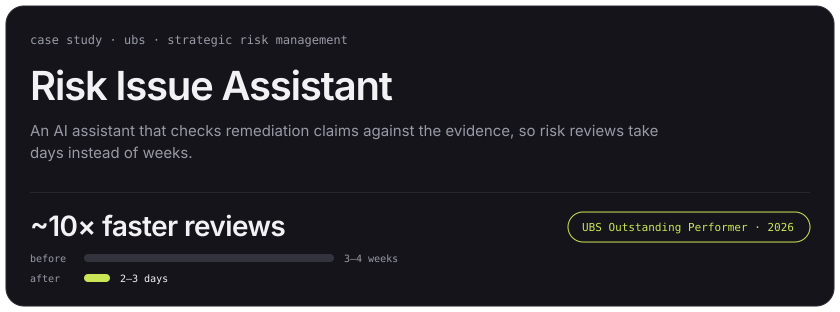
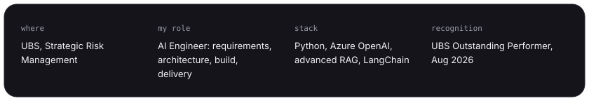
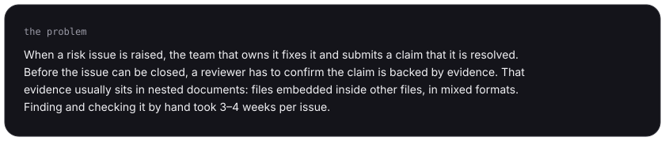
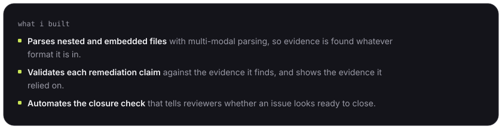
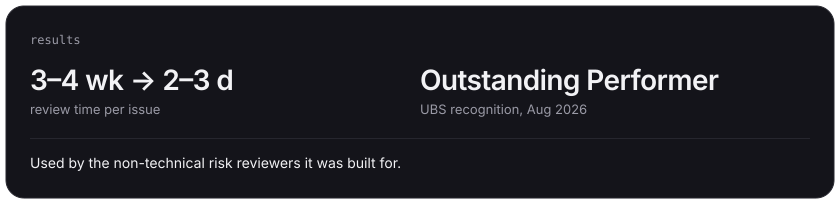
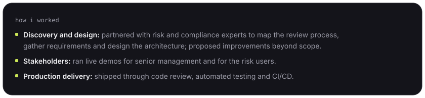
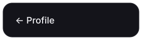
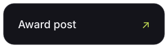
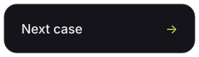

<!-- Generated by scripts/build_assets.py: edit CASE_STUDIES there, then re-run. -->

Details are generalised for a public page: no internal data, system names beyond the project name, or architecture specifics.

